# Ezlicious – Food Ordering and Preparation Queue System

A menu-driven Java console application that records customer orders for **Ezlicious**, a small restaurant, and processes them in the order they were received using a First-In, First-Out (FIFO) preparation queue.

---

## 1. Project Description

In a busy restaurant, orders come in faster than the kitchen can cook them. Without a clear system, orders get mixed up, customers who arrived first may be served last, and staff cannot easily tell what is still pending.

This application addresses that problem by:

- **Recording** every customer order (customer name, items, quantities, and total amount).
- **Queueing** each new order in a preparation queue so the kitchen always cooks the oldest order first.
- **Tracking** each order's status (`Pending` or `Completed`).
- **Sorting and searching** the records so staff can quickly review orders by order number, customer name, or total amount.

The program follows a **procedural approach**: it uses only the `main` method, static methods, arrays, multiple `ArrayList`s, and a Java `Queue`. No custom classes or objects are used for the records or the logic.

---

## 2. Objectives

1. Implement sorting algorithms (Bubble Sort and Insertion Sort) to arrange order records by specified criteria.
2. Apply queue operations to manage orders using the FIFO principle.
3. Use Java `ArrayList`s to store and manage related order information.
4. Apply loops, conditional statements, methods, and input validation to solve programming problems.
5. Develop a functional console-based application that integrates sorting algorithms and a queue.
6. Demonstrate the correct operation of the application and explain the logic behind the implementation.

---

## 3. Use Cases and Features

### The Ezlicious Menu

| Category | Item | Price |
|---|---|---|
| THE MAIN EVENT (Burgers) | The Classic Ez-Burger | PHP 250.00 |
| | The Double Smash | PHP 350.00 |
| | The Spicy Volcano Burger | PHP 280.00 |
| EZ-BITES (Chicken & Wings) | Garlic Parm Wings (6 pcs) | PHP 400.00 |
| | Sticky Sweet BBQ Pops | PHP 300.00 |
| | Crunchy Chicken Tenders | PHP 220.00 |
| ON THE SIDE | Loaded Bacon & Cheese Fries | PHP 150.00 |
| | Golden Onion Rings | PHP 120.00 |
| | Cheesy Mac Bites | PHP 140.00 |
| SIPS & SHAKES | Creamy Vanilla Shake | PHP 120.00 |
| | Double Choco Fudge Shake | PHP 140.00 |
| | Ez-Lemon Iced Tea | PHP 80.00 |
| SWEET TREATS (Desserts) | Warm Brownie Sundae | PHP 150.00 |
| | Fried Apple Pie Bites | PHP 100.00 |

### Main Menu Options

| # | Option | What it does |
|---|---|---|
| 1 | View Menu | Displays all menu items grouped by category with prices. |
| 2 | Take New Order | Asks for the customer name, lets the user add menu items and quantities, computes the total, saves the record, and **enqueues** the order. |
| 3 | Prepare Next Order | **Dequeues** the oldest order and marks it `Completed`. |
| 4 | Peek Next Order | Shows the next order to be prepared **without removing** it from the queue. |
| 5 | Display Preparation Queue | Lists all waiting orders from front to back. |
| 6 | Check if Queue is Empty | Reports whether any orders are waiting. |
| 7 | Display All Orders | Shows every stored order record. |
| 8 | Display Pending and Completed Orders | Shows pending and completed orders in two separate lists. |
| 9 | Search Order | Finds orders by exact order number or by (partial) customer name. |
| 10 | Sort Orders | Sorts records by order number, customer name, or total amount, showing the records **before and after** sorting. |
| 11 | Exit | Ends the program properly. |

### Input Validation and Messages

- Invalid menu choices, non-numeric input, and out-of-range numbers are rejected, and the user is asked again. The program never crashes on bad input.
- Blank customer names are not accepted.
- Clear messages are shown for an empty queue, no recorded orders, no pending or completed orders, orders not found, and cancelled orders (an order with no items is not saved).

---

## 4. Data Structure Explanation

### ArrayLists (Order Records)

Each order is stored across **five parallel `ArrayList`s**. The value at index `i` in every list belongs to the **same order**.

| ArrayList | Type | Stores |
|---|---|---|
| `orderNumbers` | `ArrayList<Integer>` | Unique order number (starts at 1001) |
| `customerNames` | `ArrayList<String>` | Name of the customer |
| `orderDetails` | `ArrayList<String>` | Items ordered, e.g. `2x The Classic Ez-Burger, 1x Ez-Lemon Iced Tea` |
| `orderTotals` | `ArrayList<Double>` | Total amount in PHP |
| `orderStatus` | `ArrayList<String>` | `Pending` or `Completed` |

The menu itself is stored in three fixed arrays (`menuCategory`, `menuName`, `menuPrice`) that share the same index for each item.

**Keeping the lists synchronized:** whenever records are rearranged, the method `swapRecords(i, j)` swaps the data of two records in **all five lists at once**. This guarantees that a customer name always stays attached to the correct items, total, and status, even after sorting.

### Queue (Preparation Queue)

```java
static Queue<Integer> prepQueue = new LinkedList<>();
```

The queue is a Java `Queue` implemented with `LinkedList`. It stores the **order numbers** of orders that are waiting to be cooked.

| Queue operation | Where it is used in the system |
|---|---|
| `add()` – enqueue | Taking a new order places it at the back of the queue. |
| `poll()` – dequeue | "Prepare Next Order" removes the order at the front and marks it `Completed`. |
| `peek()` | "Peek Next Order" shows who is next without removing the order. |
| iteration | "Display Preparation Queue" lists the orders from front to back. |
| `isEmpty()` / `size()` | Checks for an empty queue and counts waiting orders. |

**FIFO in practice:** the first order placed is the first order prepared. An order can only become `Completed` by being dequeued, so the queue controls the actual workflow of the restaurant and is not just an added feature.

**Why the queue stores order numbers instead of positions:** sorting changes the positions of records in the ArrayLists. Because the queue holds order numbers, the system can always find the correct record (`findIndexByOrderNumber`) and the queue order is never affected by sorting.

---

## 5. Sorting Algorithm Explanation

Both algorithms are written manually. Java's built-in sorting methods (`Collections.sort`, `Arrays.sort`, etc.) are **not** used.

### Bubble Sort – by Order Number and Total Amount

- **How it works:** repeatedly compares two neighboring records and swaps them if they are in the wrong order. After each pass, the largest (or smallest) remaining value "bubbles" to its final position. If a full pass makes no swaps, the sort stops early.
- **How it is used:** option 10 → *Order number* or *Total amount*, in ascending or descending order.
- **Why it is suitable:** the numeric keys are simple to compare, the number of orders in a small restaurant is small, and the early-exit check makes it fast when the records are already nearly sorted (as order numbers usually are).

### Insertion Sort – by Customer Name

- **How it works:** takes each record and slides it to the left until it sits in its correct alphabetical position, like arranging playing cards in your hand. Names are compared ignoring uppercase and lowercase.
- **How it is used:** option 10 → *Customer name (A–Z)*.
- **Why it is suitable:** it works well on small lists that keep growing as new orders arrive, and it is **stable**, meaning customers with the same name stay in the order they placed their orders.

For both algorithms the system displays the records **before** and **after** sorting.

---

## 6. How to Run the Program

### Requirements

- Java Development Kit (JDK) 8 or higher
- A terminal or command prompt

To check that Java is installed:

```bash
java -version
javac -version
```

### Steps

1. Place `EzliciousOrderSystem.java` in a folder.
2. Open a terminal in that folder.
3. Compile the program:

   ```bash
   javac EzliciousOrderSystem.java
   ```

4. Run the program:

   ```bash
   java EzliciousOrderSystem
   ```

5. Type the number of the menu option you want and press **Enter**.

### Typical Workflow

1. Choose **2** to take one or more orders.
2. Choose **5** to see the preparation queue.
3. Choose **3** to prepare the next order (the oldest one is served first).
4. Choose **8** to see pending and completed orders.
5. Choose **10** to sort the records, or **9** to search.
6. Choose **11** to exit.

---

## 7. Screenshots of the System

The screenshots below were taken from the running application using these sample orders:

| Order # | Customer | Items | Total |
|---|---|---|---|
| 1001 | Maria | 2x The Classic Ez-Burger | PHP 500.00 |
| 1002 | Juan | 1x Garlic Parm Wings (6 pcs), 2x Ez-Lemon Iced Tea | PHP 560.00 |
| 1003 | Ana | 1x Warm Brownie Sundae | PHP 150.00 |

### 7.1 Main Menu

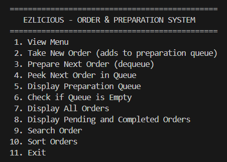

*The main menu showing all 11 options.*

### 7.2 Adding Records

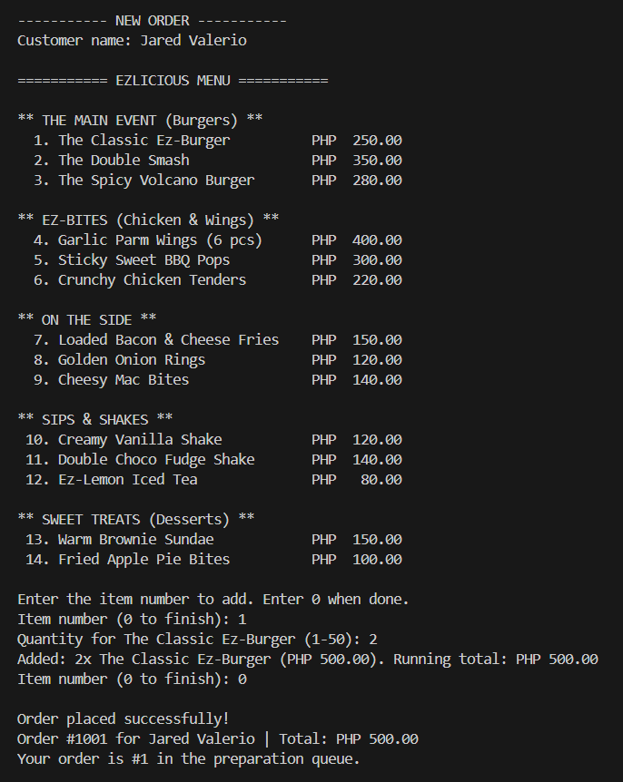

*Option 2: entering the customer name, selecting menu items and quantities, and the order being saved and added to the queue.*

### 7.3 Displaying Stored Records

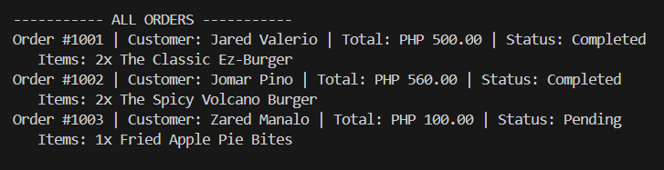

*Option 7: all stored order records with customer name, items, total, and status.*

### 7.4 Queue Operations

**Enqueue** – each new order joins the back of the queue (shown in 7.2 and in the queue display below).

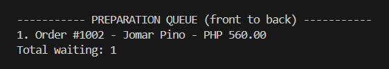

*Option 5: the preparation queue listed from front to back.*

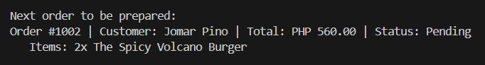

*Option 4 (Peek): shows the next order without removing it.*

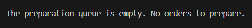

*Option 3 (Dequeue): the next order is removed from the queue and marked Completed.*

### 7.5 FIFO Behavior


*Orders were placed in the order Jared Valerio (#1001), Jomar Pino (#1002), and Zared Manalo (#1003). They are prepared in the same order: Jared first, then Jomar and lastly Zared,.*

### 7.6 Pending and Completed Orders

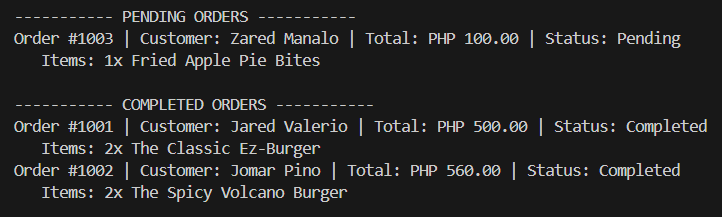

*Option 8: pending and completed orders displayed in separate lists.*

### 7.7 Search

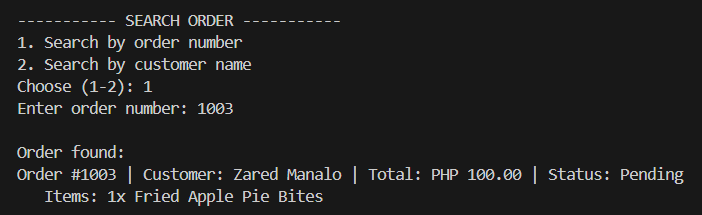

*Option 9: searching for an order by order number or customer name.*

### 7.8 Sorting Algorithm 1 – Bubble Sort

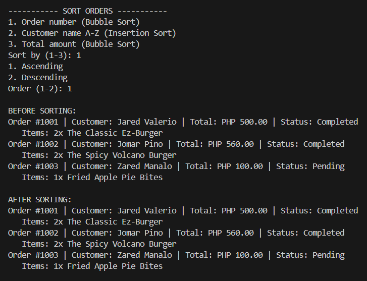

*Option 10 → Total amount (Bubble Sort). The records before sorting and after sorting by total amount.*

### 7.9 Sorting Algorithm 2 – Insertion Sort

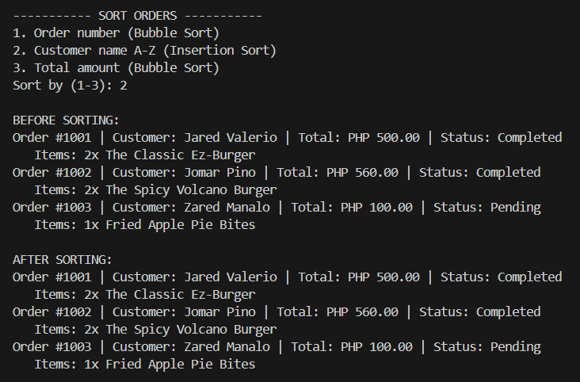

*Option 10 → Customer name (Insertion Sort). The records before sorting and after sorting alphabetically by customer name.*

### 7.10 Input Validation and Error Messages

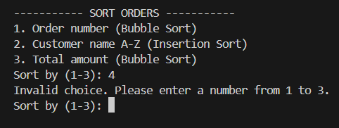

*Invalid inputs (letters, out-of-range numbers, blank name) are rejected with clear messages and the user is asked again.*

### 7.11 Empty Queue Message

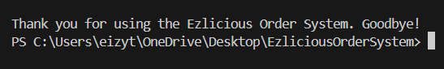

*Preparing, peeking, or displaying the queue when no orders are waiting shows an appropriate message instead of an error.*

---

## 8. Project Structure

```
Ezlicious/
├── EzliciousOrderSystem.java
├── README.md
└── screenshots/
    ├── 01-main-menu.png
    ├── 02-add-order.png
    ├── 03-display-all-orders.png
    ├── 04-display-queue.png
    ├── 05-peek.png
    ├── 06-dequeue.png
    ├── 07-fifo.png
    ├── 08-pending-completed.png
    ├── 09-search.png
    ├── 10-bubble-sort.png
    ├── 11-insertion-sort.png
    ├── 12-input-validation.png
    └── 13-empty-queue.png
```

---

## 9. Programming Concepts Applied

- **Procedural programming:** only `main` and static methods; no custom classes, inheritance, or custom objects.
- **Loops:** the main menu loop, item-entry loop, search loops, and sorting loops.
- **Conditional statements:** menu handling (`switch`), validation checks, and status filtering.
- **Methods:** each feature is a separate static method (`takeNewOrder`, `prepareNextOrder`, `bubbleSortByTotal`, `insertionSortByName`, etc.).
- **Input validation:** `readInt()` and `readNonEmptyString()` repeat the prompt until the input is valid.

## Ezlicious created by Eizy Silva with the help of AI